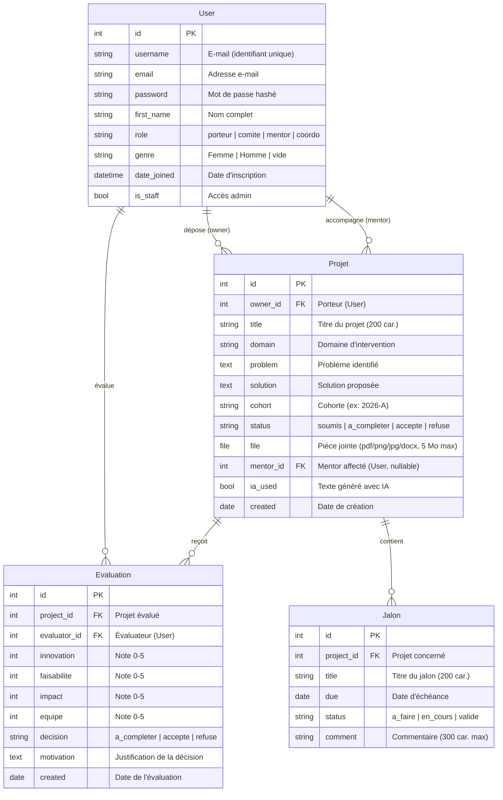

# Schéma et dictionnaire de la base de données

## Diagramme Entité-Relation

## Dictionnaire des données

### Table `User` (extends AbstractUser)
| Champ | Type | Contraintes | Description |
|---|---|---|---|
| `id` | BigAutoField | PK, auto-incrémenté | Identifiant unique |
| `username` | CharField(150) | Unique, obligatoire | E-mail utilisé comme identifiant |
| `email` | EmailField | — | Adresse e-mail |
| `password` | CharField | Hashé (PBKDF2) | Mot de passe sécurisé |
| `first_name` | CharField(150) | — | Nom complet de l'utilisateur |
| `role` | CharField(10) | Choix : porteur, comite, mentor, coordo | Rôle déterminant les droits d'accès |
| `genre` | CharField(10) | Choix : Femme, Homme, vide | Genre (statistiques) |
| `is_staff` | BooleanField | Défaut : False | Accès à l'interface admin |
| `date_joined` | DateTimeField | Auto | Date de création du compte |

### Table `Projet`
| Champ | Type | Contraintes | Description |
|---|---|---|---|
| `id` | BigAutoField | PK | Identifiant unique |
| `owner_id` | ForeignKey(User) | CASCADE, obligatoire | Porteur du projet |
| `title` | CharField(200) | Obligatoire | Titre du projet |
| `domain` | CharField(100) | Choix parmi 7 domaines CIAT | Domaine d'intervention |
| `problem` | TextField | Facultatif | Description du problème identifié |
| `solution` | TextField | Facultatif | Description de la solution proposée |
| `cohort` | CharField(20) | Défaut : « 2026-A » | Cohorte d'incubation |
| `status` | CharField(12) | Choix : soumis, a_completer, accepte, refuse | Statut courant du dossier |
| `file` | FileField | Extensions : pdf, png, jpg, jpeg, docx ; 5 Mo max | Pièce jointe |
| `mentor_id` | ForeignKey(User) | SET_NULL, nullable, rôle=mentor | Mentor affecté |
| `ia_used` | BooleanField | Défaut : False | Indique si l'IA a été utilisée |
| `created` | DateField | Défaut : date du jour | Date de création du dossier |

### Table `Evaluation`
| Champ | Type | Contraintes | Description |
|---|---|---|---|
| `id` | BigAutoField | PK | Identifiant unique |
| `project_id` | ForeignKey(Projet) | CASCADE | Projet évalué |
| `evaluator_id` | ForeignKey(User) | CASCADE | Membre du comité ayant évalué |
| `innovation` | PositiveSmallIntegerField | 0 ≤ valeur ≤ 5 | Note d'innovation |
| `faisabilite` | PositiveSmallIntegerField | 0 ≤ valeur ≤ 5 | Note de faisabilité |
| `impact` | PositiveSmallIntegerField | 0 ≤ valeur ≤ 5 | Note d'impact |
| `equipe` | PositiveSmallIntegerField | 0 ≤ valeur ≤ 5 | Note de l'équipe |
| `decision` | CharField(12) | Choix : a_completer, accepte, refuse | Décision prise |
| `motivation` | TextField | Obligatoire | Justification de la décision |
| `created` | DateField | Défaut : date du jour | Date de l'évaluation |

**Propriété calculée :** `total` = innovation + faisabilité + impact + équipe (sur 20)

### Table `Jalon`
| Champ | Type | Contraintes | Description |
|---|---|---|---|
| `id` | BigAutoField | PK | Identifiant unique |
| `project_id` | ForeignKey(Projet) | CASCADE | Projet concerné |
| `title` | CharField(200) | Obligatoire | Titre du jalon |
| `due` | DateField | Obligatoire | Date d'échéance |
| `status` | CharField(10) | Choix : a_faire, en_cours, valide | État d'avancement |
| `comment` | CharField(300) | Facultatif | Commentaire du mentor ou coordonnateur |

**Propriété calculée :** `en_retard` = True si statut ≠ « validé » et échéance < aujourd'hui

## Relations et règles métier

1. Un **porteur** peut avoir plusieurs projets ; un projet appartient à un seul porteur.
2. Un **mentor** peut suivre plusieurs projets ; un projet a au plus un mentor.
3. L'affectation de mentor n'est possible que si le projet est **accepté**.
4. Un projet peut recevoir plusieurs **évaluations** ; chaque évaluation met à jour le statut.
5. Les **jalons** sont ordonnés par date d'échéance ; un retard est signalé automatiquement.
6. La suppression d'un utilisateur supprime ses projets (CASCADE) mais libère ses projets mentorés (SET_NULL).
